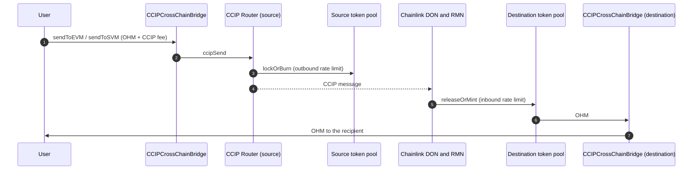
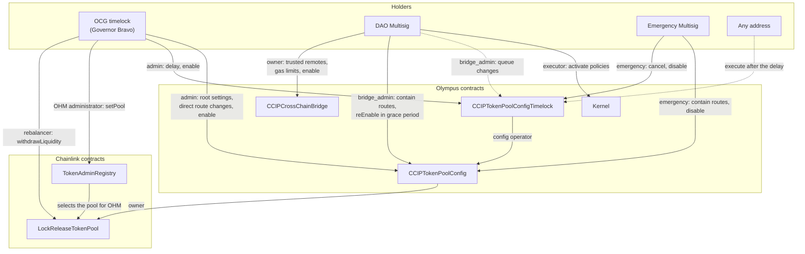
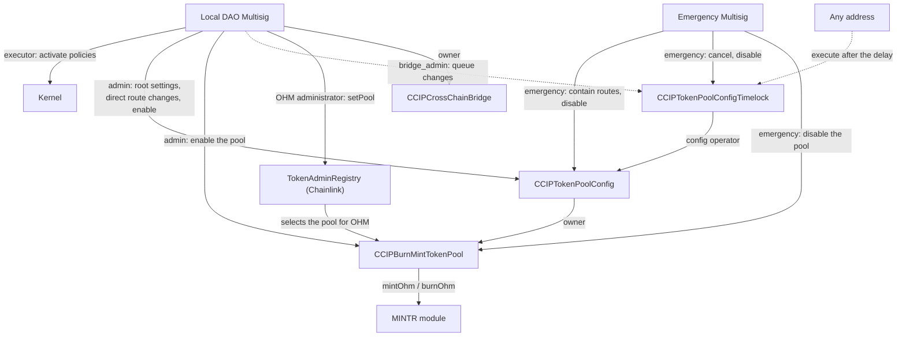
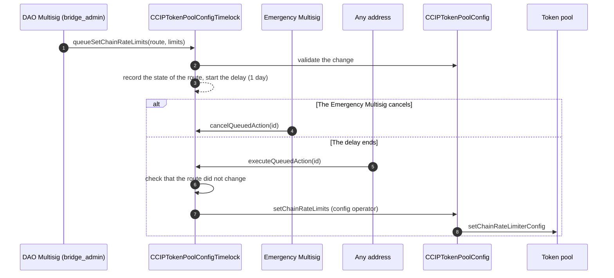
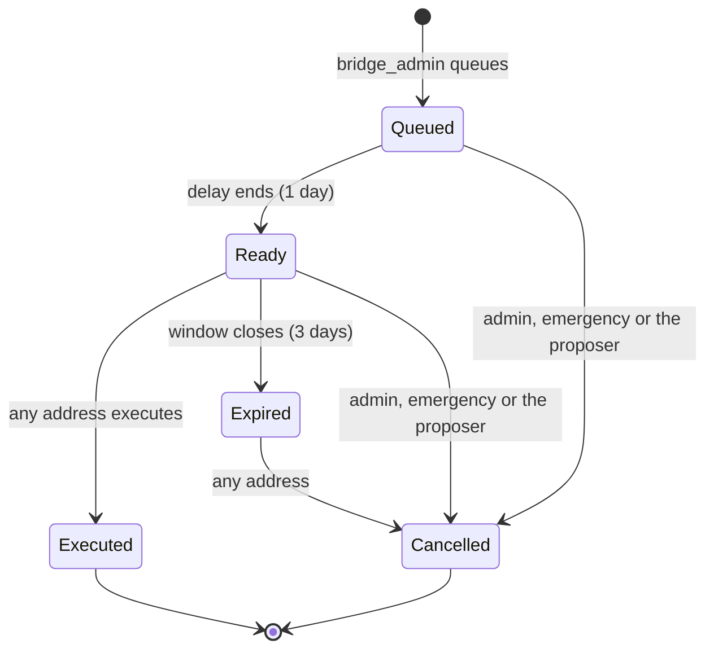
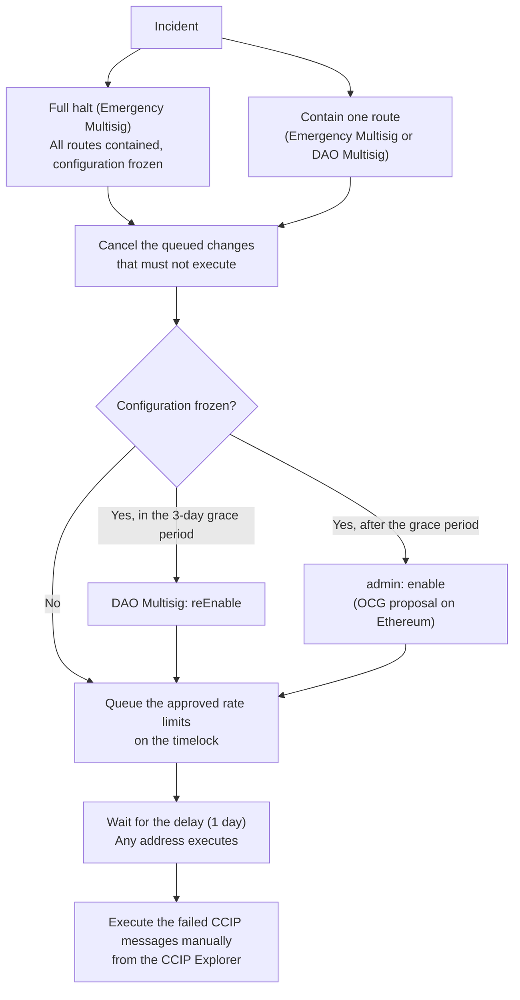
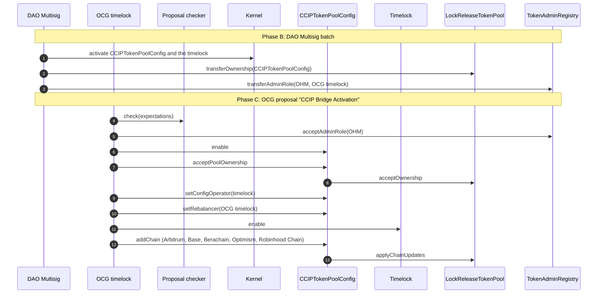
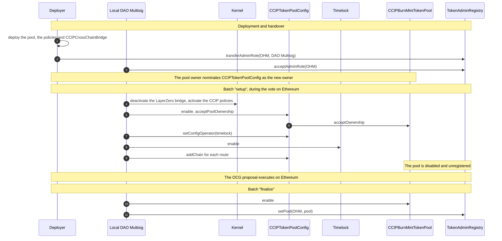

# Cross-Chain Bridge: Technical Details

This page describes the Olympus bridge on Chainlink CCIP. For a summary and the steps to bridge, refer to the [Cross-Chain Bridge](./index.md) overview.

In this page, "the other EVM chains" means Arbitrum, Optimism, Base, Berachain and Robinhood Chain.

## Supply model

Ethereum is the canonical chain. Only Ethereum can mint net-new protocol OHM.

| Chain                | Token pool                       | Outbound transfer         | Inbound transfer           |
| -------------------- | -------------------------------- | ------------------------- | -------------------------- |
| Ethereum             | Chainlink `LockReleaseTokenPool` | Locks OHM in the pool     | Releases OHM from the pool |
| The other EVM chains | Olympus `CCIPBurnMintTokenPool`  | Burns OHM through `MINTR` | Mints OHM through `MINTR`  |
| Solana               | CCIP burn/mint token pool        | Burns OHM                 | Mints OHM                  |

The Ethereum pool backs all of the OHM on the other chains. Before the OCG proposal, the DAO Multisig transferred OHM to the pool. A deposit does not need a role. The deposit backs the supply on Arbitrum, Optimism, Base and Berachain, approximately 130,721 OHM. The LayerZero bridge minted that supply against burns on Ethereum. The OCG proposal that opens the lanes checks the pool balance first. If the balance is less than the required backing, the proposal does not execute.

The OHM token on Robinhood Chain starts with a supply of zero. OHM arrives there only through CCIP: from Ethereum against OHM that is locked in the pool, or from Arbitrum or Base against OHM that is burned there. Thus, Robinhood Chain is not part of the deposit.

The burn/mint pools can mint only when OHM arrives through CCIP. Thus, OHM that moves between two burn/mint chains does not touch the Ethereum pool. The total OHM outside Ethereum stays backed by the Ethereum pool.

## Contracts

| Contract                             | Chains                         | Purpose                                                                                                                                                      |
| ------------------------------------ | ------------------------------ | ------------------------------------------------------------------------------------------------------------------------------------------------------------ |
| `LockReleaseTokenPool`               | Ethereum                       | The Chainlink token pool that locks and releases OHM. Chainlink wrote and audited this contract. The addresses table lists it as `CCIPLockReleaseTokenPool`. |
| `CCIPBurnMintTokenPool`              | The other EVM chains           | An Olympus policy that burns and mints OHM through the `MINTR` module.                                                                                       |
| `CCIPTokenPoolConfig`                | Ethereum, the other EVM chains | An Olympus policy that owns the local token pool. It gives each role access to a limited set of pool functions. It does not forward arbitrary calls.         |
| `CCIPTokenPoolConfigTimelock`        | Ethereum, the other EVM chains | An Olympus policy that queues route and rate-limit changes and executes them after a delay.                                                                  |
| `CCIPCrossChainBridge`               | Ethereum, the other EVM chains | The bridge contract that the Olympus app uses. It is optional: any address can send OHM through the CCIP router directly.                                    |
| `CCIPTokenPoolConfigProposalChecker` | Ethereum                       | A read-only contract. The OCG proposal calls it first, to make sure that the live state is correct before the handover.                                      |
| `TokenAdminRegistry`                 | Each chain                     | The Chainlink registry that selects the token pool for OHM. On Ethereum, the OCG timelock is the OHM administrator.                                          |

## Deployments

The tables give the bridge contracts and the related accounts on each chain. All Olympus addresses are also in the [contract addresses table](../../contracts/01_addresses.md).

### Ethereum

CCIP chain selector: `5009297550715157269`

| Contract                             | Address                                                                                                                 |
| ------------------------------------ | ----------------------------------------------------------------------------------------------------------------------- |
| OHM                                  | [`0x64aa3364F17a4D01c6f1751Fd97C2BD3D7e7f1D5`](https://etherscan.io/address/0x64aa3364F17a4D01c6f1751Fd97C2BD3D7e7f1D5) |
| `LockReleaseTokenPool`               | [`0xa5588e518CE5ee0e4628C005E4edAbD5e87de3aD`](https://etherscan.io/address/0xa5588e518CE5ee0e4628C005E4edAbD5e87de3aD) |
| `CCIPTokenPoolConfig`                | [`0x2CEA7B722dbd6b03f0E857d11e53ECB698cC2b4E`](https://etherscan.io/address/0x2CEA7B722dbd6b03f0E857d11e53ECB698cC2b4E) |
| `CCIPTokenPoolConfigTimelock`        | [`0xF489F38BF8d98A5C10a030f8C16624f6764CD27A`](https://etherscan.io/address/0xF489F38BF8d98A5C10a030f8C16624f6764CD27A) |
| `CCIPCrossChainBridge`               | [`0xFbf6383dC3F6010d403Ecdf12DDC1311701D143D`](https://etherscan.io/address/0xFbf6383dC3F6010d403Ecdf12DDC1311701D143D) |
| `CCIPTokenPoolConfigProposalChecker` | [`0x1b1FB8C6E0420C6595a016Dd8AD962176aa564c9`](https://etherscan.io/address/0x1b1FB8C6E0420C6595a016Dd8AD962176aa564c9) |
| Kernel                               | [`0x2286d7f9639e8158FaD1169e76d1FbC38247f54b`](https://etherscan.io/address/0x2286d7f9639e8158FaD1169e76d1FbC38247f54b) |
| DAO Multisig                         | [`0x245cc372C84B3645Bf0Ffe6538620B04a217988B`](https://etherscan.io/address/0x245cc372C84B3645Bf0Ffe6538620B04a217988B) |
| Emergency Multisig                   | [`0xa8A6ff2606b24F61AFA986381D8991DFcCCd2D55`](https://etherscan.io/address/0xa8A6ff2606b24F61AFA986381D8991DFcCCd2D55) |
| OCG timelock                         | [`0x953EA3223d2dd3c1A91E9D6cca1bf7Af162C9c39`](https://etherscan.io/address/0x953EA3223d2dd3c1A91E9D6cca1bf7Af162C9c39) |
| CCIP Router (Chainlink)              | [`0x80226fc0Ee2b096224EeAc085Bb9a8cba1146f7D`](https://etherscan.io/address/0x80226fc0Ee2b096224EeAc085Bb9a8cba1146f7D) |
| `TokenAdminRegistry` (Chainlink)     | [`0xb22764f98dD05c789929716D677382Df22C05Cb6`](https://etherscan.io/address/0xb22764f98dD05c789929716D677382Df22C05Cb6) |

### Arbitrum

CCIP chain selector: `4949039107694359620`

| Contract                         | Address                                                                                                                |
| -------------------------------- | ---------------------------------------------------------------------------------------------------------------------- |
| OHM                              | [`0xf0cb2dc0db5e6c66B9a70Ac27B06b878da017028`](https://arbiscan.io/address/0xf0cb2dc0db5e6c66B9a70Ac27B06b878da017028) |
| `CCIPBurnMintTokenPool`          | [`0xF35193DA8C10e44aF10853Ba5a3a1a6F7529E39a`](https://arbiscan.io/address/0xF35193DA8C10e44aF10853Ba5a3a1a6F7529E39a) |
| `CCIPTokenPoolConfig`            | [`0x5824850D8A6E46a473445a5AF214C7EbD46c5ECB`](https://arbiscan.io/address/0x5824850D8A6E46a473445a5AF214C7EbD46c5ECB) |
| `CCIPTokenPoolConfigTimelock`    | [`0x5261fBA7B50aA22B19B9edF939b771D109dE991F`](https://arbiscan.io/address/0x5261fBA7B50aA22B19B9edF939b771D109dE991F) |
| `CCIPCrossChainBridge`           | [`0xb4f620c39F3BA4a1E7aD264fEd6239B0C618DB50`](https://arbiscan.io/address/0xb4f620c39F3BA4a1E7aD264fEd6239B0C618DB50) |
| Kernel                           | [`0xeac3eC0CC130f4826715187805d1B50e861F2DaC`](https://arbiscan.io/address/0xeac3eC0CC130f4826715187805d1B50e861F2DaC) |
| DAO Multisig                     | [`0x012BBf0481b97170577745D2167ee14f63E2aD4C`](https://arbiscan.io/address/0x012BBf0481b97170577745D2167ee14f63E2aD4C) |
| Emergency Multisig               | [`0xa8A6ff2606b24F61AFA986381D8991DFcCCd2D55`](https://arbiscan.io/address/0xa8A6ff2606b24F61AFA986381D8991DFcCCd2D55) |
| CCIP Router (Chainlink)          | [`0x141fa059441E0ca23ce184B6A78bafD2A517DdE8`](https://arbiscan.io/address/0x141fa059441E0ca23ce184B6A78bafD2A517DdE8) |
| `TokenAdminRegistry` (Chainlink) | [`0x39AE1032cF4B334a1Ed41cdD0833bdD7c7E7751E`](https://arbiscan.io/address/0x39AE1032cF4B334a1Ed41cdD0833bdD7c7E7751E) |

### Optimism

CCIP chain selector: `3734403246176062136`

| Contract                         | Address                                                                                                                            |
| -------------------------------- | ---------------------------------------------------------------------------------------------------------------------------------- |
| OHM                              | [`0x060cb087a9730E13aa191f31A6d86bFF8DfcdCC0`](https://optimistic.etherscan.io/address/0x060cb087a9730E13aa191f31A6d86bFF8DfcdCC0) |
| `CCIPBurnMintTokenPool`          | [`0xD98B5b2E4D5d6Cd554115DE19EfB7A9084BEddd1`](https://optimistic.etherscan.io/address/0xD98B5b2E4D5d6Cd554115DE19EfB7A9084BEddd1) |
| `CCIPTokenPoolConfig`            | [`0x20a3d8510f2e1176E8Db4CeA9883a8287a9029Db`](https://optimistic.etherscan.io/address/0x20a3d8510f2e1176E8Db4CeA9883a8287a9029Db) |
| `CCIPTokenPoolConfigTimelock`    | [`0xEBDe552D851DD6Dfd3D360C596D3F4aF6e5F9678`](https://optimistic.etherscan.io/address/0xEBDe552D851DD6Dfd3D360C596D3F4aF6e5F9678) |
| `CCIPCrossChainBridge`           | [`0xcb4E21Eb404d80F3e1dB781aAd9AD6A1217fbbf2`](https://optimistic.etherscan.io/address/0xcb4E21Eb404d80F3e1dB781aAd9AD6A1217fbbf2) |
| Kernel                           | [`0x18878Df23e2a36f81e820e4b47b4A40576D3159C`](https://optimistic.etherscan.io/address/0x18878Df23e2a36f81e820e4b47b4A40576D3159C) |
| DAO Multisig                     | [`0x559a14a2219Ae81f9a9f857CF31407de2b07F36c`](https://optimistic.etherscan.io/address/0x559a14a2219Ae81f9a9f857CF31407de2b07F36c) |
| Emergency Multisig               | [`0xa8A6ff2606b24F61AFA986381D8991DFcCCd2D55`](https://optimistic.etherscan.io/address/0xa8A6ff2606b24F61AFA986381D8991DFcCCd2D55) |
| CCIP Router (Chainlink)          | [`0x3206695CaE29952f4b0c22a169725a865bc8Ce0f`](https://optimistic.etherscan.io/address/0x3206695CaE29952f4b0c22a169725a865bc8Ce0f) |
| `TokenAdminRegistry` (Chainlink) | [`0x657c42abE4CD8aa731Aec322f871B5b90cf6274F`](https://optimistic.etherscan.io/address/0x657c42abE4CD8aa731Aec322f871B5b90cf6274F) |

### Base

CCIP chain selector: `15971525489660198786`

| Contract                         | Address                                                                                                                 |
| -------------------------------- | ----------------------------------------------------------------------------------------------------------------------- |
| OHM                              | [`0x060cb087a9730E13aa191f31A6d86bFF8DfcdCC0`](https://basescan.org/address/0x060cb087a9730E13aa191f31A6d86bFF8DfcdCC0) |
| `CCIPBurnMintTokenPool`          | [`0x20a3d8510f2e1176E8Db4CeA9883a8287a9029Db`](https://basescan.org/address/0x20a3d8510f2e1176E8Db4CeA9883a8287a9029Db) |
| `CCIPTokenPoolConfig`            | [`0xF35193DA8C10e44aF10853Ba5a3a1a6F7529E39a`](https://basescan.org/address/0xF35193DA8C10e44aF10853Ba5a3a1a6F7529E39a) |
| `CCIPTokenPoolConfigTimelock`    | [`0xb4f620c39F3BA4a1E7aD264fEd6239B0C618DB50`](https://basescan.org/address/0xb4f620c39F3BA4a1E7aD264fEd6239B0C618DB50) |
| `CCIPCrossChainBridge`           | [`0xEBDe552D851DD6Dfd3D360C596D3F4aF6e5F9678`](https://basescan.org/address/0xEBDe552D851DD6Dfd3D360C596D3F4aF6e5F9678) |
| Kernel                           | [`0x18878Df23e2a36f81e820e4b47b4A40576D3159C`](https://basescan.org/address/0x18878Df23e2a36f81e820e4b47b4A40576D3159C) |
| DAO Multisig                     | [`0x18a390bD45bCc92652b9A91AD51Aed7f1c1358f5`](https://basescan.org/address/0x18a390bD45bCc92652b9A91AD51Aed7f1c1358f5) |
| Emergency Multisig               | [`0xa8A6ff2606b24F61AFA986381D8991DFcCCd2D55`](https://basescan.org/address/0xa8A6ff2606b24F61AFA986381D8991DFcCCd2D55) |
| CCIP Router (Chainlink)          | [`0x881e3A65B4d4a04dD529061dd0071cf975F58bCD`](https://basescan.org/address/0x881e3A65B4d4a04dD529061dd0071cf975F58bCD) |
| `TokenAdminRegistry` (Chainlink) | [`0x6f6C373d09C07425BaAE72317863d7F6bb731e37`](https://basescan.org/address/0x6f6C373d09C07425BaAE72317863d7F6bb731e37) |

### Berachain

CCIP chain selector: `1294465214383781161`

| Contract                         | Address                                                                                                                 |
| -------------------------------- | ----------------------------------------------------------------------------------------------------------------------- |
| OHM                              | [`0x18878Df23e2a36f81e820e4b47b4A40576D3159C`](https://berascan.com/address/0x18878Df23e2a36f81e820e4b47b4A40576D3159C) |
| `CCIPBurnMintTokenPool`          | [`0xEBDe552D851DD6Dfd3D360C596D3F4aF6e5F9678`](https://berascan.com/address/0xEBDe552D851DD6Dfd3D360C596D3F4aF6e5F9678) |
| `CCIPTokenPoolConfig`            | [`0xb4f620c39F3BA4a1E7aD264fEd6239B0C618DB50`](https://berascan.com/address/0xb4f620c39F3BA4a1E7aD264fEd6239B0C618DB50) |
| `CCIPTokenPoolConfigTimelock`    | [`0x5824850D8A6E46a473445a5AF214C7EbD46c5ECB`](https://berascan.com/address/0x5824850D8A6E46a473445a5AF214C7EbD46c5ECB) |
| `CCIPCrossChainBridge`           | [`0xF35193DA8C10e44aF10853Ba5a3a1a6F7529E39a`](https://berascan.com/address/0xF35193DA8C10e44aF10853Ba5a3a1a6F7529E39a) |
| Kernel                           | [`0x623164A9Ee2556D524b08f34F1d2389d7B4e1A1C`](https://berascan.com/address/0x623164A9Ee2556D524b08f34F1d2389d7B4e1A1C) |
| DAO Multisig                     | [`0x91494D1BC2286343D51c55E46AE80C9356D099b5`](https://berascan.com/address/0x91494D1BC2286343D51c55E46AE80C9356D099b5) |
| Emergency Multisig               | [`0xa8A6ff2606b24F61AFA986381D8991DFcCCd2D55`](https://berascan.com/address/0xa8A6ff2606b24F61AFA986381D8991DFcCCd2D55) |
| CCIP Router (Chainlink)          | [`0x71a275704c283486fBa26dad3dd0DB78804426eF`](https://berascan.com/address/0x71a275704c283486fBa26dad3dd0DB78804426eF) |
| `TokenAdminRegistry` (Chainlink) | [`0x0944C3Fb1dB7D165336569221995B31cBE6c8A55`](https://berascan.com/address/0x0944C3Fb1dB7D165336569221995B31cBE6c8A55) |

### Robinhood Chain

CCIP chain selector: `6180753054346818345`

| Contract                         | Address                                                                                                                                  |
| -------------------------------- | ---------------------------------------------------------------------------------------------------------------------------------------- |
| OHM                              | [`0x9c859Dc91DB65bD7375660341231227336dAa134`](https://robinhoodchain.blockscout.com/address/0x9c859Dc91DB65bD7375660341231227336dAa134) |
| `CCIPBurnMintTokenPool`          | [`0x5824850D8A6E46a473445a5AF214C7EbD46c5ECB`](https://robinhoodchain.blockscout.com/address/0x5824850D8A6E46a473445a5AF214C7EbD46c5ECB) |
| `CCIPTokenPoolConfig`            | [`0x6D94B3745B0eCF908B3B467907b947b43Fba5f15`](https://robinhoodchain.blockscout.com/address/0x6D94B3745B0eCF908B3B467907b947b43Fba5f15) |
| `CCIPTokenPoolConfigTimelock`    | [`0x9f08c2603e919a46d6D98289C9ADA5250b310558`](https://robinhoodchain.blockscout.com/address/0x9f08c2603e919a46d6D98289C9ADA5250b310558) |
| `CCIPCrossChainBridge`           | [`0x5261fBA7B50aA22B19B9edF939b771D109dE991F`](https://robinhoodchain.blockscout.com/address/0x5261fBA7B50aA22B19B9edF939b771D109dE991F) |
| Kernel                           | [`0x02331A4c97a4841084dF54d7c0eC04DD3f1A9F1c`](https://robinhoodchain.blockscout.com/address/0x02331A4c97a4841084dF54d7c0eC04DD3f1A9F1c) |
| DAO Multisig                     | [`0x317e0F5EF883DB95f8fFB5B995b8457903873608`](https://robinhoodchain.blockscout.com/address/0x317e0F5EF883DB95f8fFB5B995b8457903873608) |
| Emergency Multisig               | [`0xa8A6ff2606b24F61AFA986381D8991DFcCCd2D55`](https://robinhoodchain.blockscout.com/address/0xa8A6ff2606b24F61AFA986381D8991DFcCCd2D55) |
| CCIP Router (Chainlink)          | [`0x06fC836cf9839B1cd891C440A0a45242DA6Ae1c9`](https://robinhoodchain.blockscout.com/address/0x06fC836cf9839B1cd891C440A0a45242DA6Ae1c9) |
| `TokenAdminRegistry` (Chainlink) | [`0x1912C3cFafE8A76A32a92861d815aC2837F237Ca`](https://robinhoodchain.blockscout.com/address/0x1912C3cFafE8A76A32a92861d815aC2837F237Ca) |

### Solana

CCIP chain selector: `124615329519749607`

| Contract                    | Address                                                                                                                   |
| --------------------------- | ------------------------------------------------------------------------------------------------------------------------- |
| OHM                         | [`2Xva1NeLRuBFdK41gEuXqgeWtnKKDve9PKeCnMEpNG6K`](https://solscan.io/token/2Xva1NeLRuBFdK41gEuXqgeWtnKKDve9PKeCnMEpNG6K)   |
| CCIP token pool (Chainlink) | [`4N7bZnVSC1GE27vo2Bv6kG983brwhT68BGsLuzH5nTQp`](https://solscan.io/account/4N7bZnVSC1GE27vo2Bv6kG983brwhT68BGsLuzH5nTQp) |

## Message flow

The diagram shows a transfer between two EVM chains through `CCIPCrossChainBridge`. In these cases, `CCIPCrossChainBridge` is not used on the destination chain, and the destination pool sends the OHM to the recipient directly:

- A transfer to Solana.
- A transfer from Solana. The user sends the transfer from Solana through CCIP.
- A transfer that a user sends through the CCIP router directly.

## Rate limits

Each route has two token buckets on each side: one for outbound transfers and one for inbound transfers. A transfer uses capacity from the bucket. The bucket refills at a constant rate, and an empty bucket refills completely in 24 hours. If a transfer is larger than the available capacity, the transfer reverts on the source chain, or it fails on the destination chain.

The inbound limit on the destination is larger than the outbound limit on the source. Thus, the source limit usually applies first, and transfers do not fail on arrival.

| Route                          | Outbound limit on the source | Inbound limit on the destination |
| ------------------------------ | ---------------------------- | -------------------------------- |
| Ethereum &rarr; each EVM chain | 100,000 OHM per day          | 110,000 OHM per day              |
| Each EVM chain &rarr; Ethereum | 50,000 OHM per day           | 55,000 OHM per day               |
| EVM chain &rarr; EVM chain     | 100,000 OHM per day          | 110,000 OHM per day              |
| Ethereum &rarr; Solana         | 10,000 OHM per day           | Set on the Solana pool           |
| Solana &rarr; Ethereum         | Set on the Solana pool       | 11,000 OHM per day               |

"EVM chain" in this table means Arbitrum, Optimism, Base, Berachain or Robinhood Chain. The EVM chain &rarr; EVM chain limits apply only to the lanes that Chainlink supports. Refer to [Bridge lanes](./index.md#bridge-lanes). These values are the values at launch. The DAO Multisig can change them through the configuration timelock. The `admin` role can change them directly.

## Access control

### Authority model

| Authority                                 | Used for                                                                                        |
| ----------------------------------------- | ----------------------------------------------------------------------------------------------- |
| `admin` role                              | Root settings, direct route changes, `enable` and `disable` of the policies, the timelock delay |
| `bridge_admin` role                       | Queue route changes, contain routes, re-enable the policies in the grace period                 |
| `emergency` role                          | Contain routes, disable the policies, cancel queued changes                                     |
| `bridge_rate_limiter` role                | Reserved for a future monitoring operator                                                       |
| OHM administrator in `TokenAdminRegistry` | Select or remove the OHM token pool                                                             |
| Token pool owner                          | All token pool owner functions, through `CCIPTokenPoolConfig`                                   |
| Lock/release pool rebalancer              | Withdraw OHM from the Ethereum pool                                                             |
| `CCIPCrossChainBridge` owner              | Trusted remotes, gas limits, enable and disable the bridge contract                             |

The holder of each authority on each chain, and the permissions of each function, are in [Security Roles](../../security/01_roles.md#ccip-bridge). On Ethereum, the OCG timelock holds `admin`. There is no OCG timelock on the other EVM chains. On these chains, the local DAO Multisig holds both `admin` and `bridge_admin`.

The token pool has no direct role holders. `CCIPTokenPoolConfig` owns the pool, and the native `rateLimitAdmin` of the pool is the zero address. Thus, each change to a route or to a rate limit goes through `CCIPTokenPoolConfig`, where the roles apply.

### Ethereum

The diagram shows the authority over the bridge on Ethereum after the rollout. A solid arrow is a direct call. A dashed arrow is a call through the configuration timelock, with the delay.

### The other EVM chains

On Arbitrum, Optimism, Base, Berachain and Robinhood Chain, the local DAO Multisig replaces the OCG timelock. It holds `admin` and `bridge_admin`, it is the Kernel executor, and it is the OHM administrator in the local `TokenAdminRegistry`. The `admin` role applies to all of the policies of the local Kernel.

Because the local DAO Multisig holds `admin`, it can change a route directly, without the delay. The timelock is still available on these chains, and the Emergency Multisig can cancel a queued change.

## Configuration timelock

The `bridge_admin` role (the DAO Multisig) changes routes and rate limits through `CCIPTokenPoolConfigTimelock`:

1. The DAO Multisig queues a typed change, for example `queueAddChain` or `queueSetChainRateLimits`. The timelock validates the change when it is queued.
2. The change waits for the delay.
3. After the delay, any address can execute the change. The execution window is 3 days. After the window closes, the change expires.

| Parameter                        | Value            |
| -------------------------------- | ---------------- |
| Delay                            | 1 day            |
| Delay bounds                     | 1 day to 30 days |
| Execution window                 | 3 days           |
| Re-enable grace period           | 3 days           |
| Maximum sub-actions in one batch | 15               |

The timelock records the state of each route that a change touches. If the route changes before execution, the queued change reverts. A route can have only one queued change at a time for each part of its configuration. An expired change keeps this reservation until an address cancels it.

The `admin` role, the `emergency` role and the proposer of a change can cancel a queued change. Any address can cancel a change that expired.

The `admin` role can also change a route directly, without the timelock. On Ethereum, `admin` is the OCG timelock, so a direct change needs an OCG proposal. On the other EVM chains, `admin` is the local DAO Multisig, so a direct change has no delay.

## Emergency controls

| Control                     | Effect                                                                                                    | Who can use it                                 |
| --------------------------- | --------------------------------------------------------------------------------------------------------- | ---------------------------------------------- |
| Contain one route           | Sets the rate limits of the route to almost zero. All transfers on that route fail.                       | Emergency Multisig, DAO Multisig, `admin`      |
| Contain all routes          | Contains every route of the chain.                                                                        | Emergency Multisig, DAO Multisig, `admin`      |
| Freeze the configuration    | Disables `CCIPTokenPoolConfig` and the timelock. No change can be queued or executed. Transfers continue. | Emergency Multisig, `admin`                    |
| Full halt                   | Contains every route and freezes the configuration in one transaction.                                    | Emergency Multisig, `admin`                    |
| Disable the token pool      | Disables `CCIPBurnMintTokenPool` on one of the other EVM chains. The pool cannot burn or mint.            | Emergency Multisig, local `admin`              |
| Disable the bridge contract | Stops `CCIPCrossChainBridge`. Transfers through the router continue.                                      | Owner of `CCIPCrossChainBridge` (DAO Multisig) |
| Withdraw the Ethereum pool  | Removes OHM from the Ethereum pool and limits the OHM that can return to Ethereum.                        | Rebalancer (OCG proposal)                      |

Containment can only decrease capacity. To restore a route after containment, the DAO Multisig queues the approved rate limits on the timelock. A restore through the timelock waits for the delay. The `admin` role can restore the rate limits directly: on Ethereum through an OCG proposal, and on the other EVM chains from the local DAO Multisig.

A contained route does not stop the timelock. A queued change can still execute. In an incident, use the full halt, or cancel the queued changes.

After a policy is disabled, the DAO Multisig can re-enable it within the 3-day grace period. After the grace period, only the `admin` role can enable it. `CCIPBurnMintTokenPool` has no grace period: only the local `admin` role can enable it again.

### Incident response and recovery

When a route is restored, its buckets do not refill immediately. The capacity starts from almost zero and refills at the configured rate.

## Rollout

The rollout moves the Ethereum pool and the OHM registry authority from the DAO Multisig to the authority model above, and it opens the EVM lanes. The steps are in this order, because each authority can only do its own part:

1. Deploy the contracts on each chain. On Ethereum, deploy `CCIPTokenPoolConfig`, the timelock and the proposal checker.
2. On each of the other EVM chains, move the OHM administrator role in the local `TokenAdminRegistry` to the local DAO Multisig.
3. Chainlink sets the OHM gas budget (at least 175,000 gas) for each lane toward a burn/mint chain.
4. The DAO Multisig deposits the backing into the Ethereum pool.
5. The DAO Multisig activates the new policies on Ethereum and nominates the new owners (batch "Phase B").
6. The DAO submits the OCG proposal. During the vote, each of the other EVM chains configures its policies and routes. Its pool stays disabled and unregistered, so the chain cannot send or receive OHM.
7. The OCG proposal executes and opens the Ethereum side of the five routes.
8. Each of the other EVM chains enables its pool and registers it in the local `TokenAdminRegistry` (batch "finalize").
9. The DAO Multisig sets the trusted remotes of each `CCIPCrossChainBridge` and enables it.

If the OCG proposal fails, the pools on the other EVM chains stay disabled and unregistered, and no rollback is necessary. A message that is sent toward a chain between steps 7 and 8 fails on arrival. Any address can execute it manually after step 8.

### Ethereum

The first action of the proposal calls `CCIPTokenPoolConfigProposalChecker`. The checker reads the live state: ownership, registry authority, roles, launch parameters, routes and the pool backing. If one value is not correct, the proposal reverts before the handover starts. The proposal includes only the actions that the live state still needs. Thus, proposal 19 has 12 actions. It does not grant `bridge_admin`, because the DAO Multisig already holds this role. It does not call `setRateLimitAdmin`, because the `rateLimitAdmin` of the pool is already the zero address.

### The other EVM chains

The pool is enabled before `setPool`, so a registered pool can always mint. Robinhood Chain has no LayerZero bridge, so its setup batch skips the deactivation. On Robinhood Chain, Chainlink proposes the local DAO Multisig as the OHM administrator, because the Robinhood OHM token has no owner function for the self-service path.

## Failed messages

A transfer can fail on the destination chain. For example, it fails if the inbound route is contained, or if the recipient on Solana has no OHM token account. There are two types of failure.

**The CCIP message failed.** The CCIP Explorer shows the message with the status `Failure`. Chainlink does not try the message again automatically. When the cause is corrected, any address can execute the message manually from the [CCIP Explorer](https://ccip.chain.link).

**The bridge contract stored the message.** If the token pool delivered the OHM but `CCIPCrossChainBridge` could not complete the transfer, the bridge contract keeps the OHM and emits `MessageFailed`. For example, this occurs if the bridge contract is disabled. When the cause is corrected, any address can call `retryFailedMessage(messageId)` on the destination `CCIPCrossChainBridge`.

## Fees

`CCIPCrossChainBridge` charges the CCIP fee in the native token of the source chain. Use `getFeeEVM` or `getFeeSVM` to get the fee before you send. If you send more native token than the fee, the bridge contract keeps the excess. Only the owner of the bridge contract can withdraw it. Olympus does not charge a bridge fee.

## Security and audits

The audits of the Olympus CCIP contracts are in the [Cross-Chain Bridge](./index.md#audits) overview. Chainlink wrote and audited the CCIP router, the on-ramps and off-ramps, `TokenAdminRegistry` and `LockReleaseTokenPool`.
