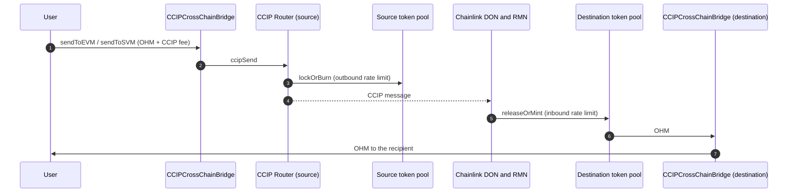

# Cross-Chain Bridge: Technical Details

This page describes the Olympus bridge on Chainlink CCIP. For a summary and the steps to bridge, refer to the [Cross-Chain Bridge](./index.md) overview.

## Supply model

Ethereum is the canonical chain. Only Ethereum can mint net-new protocol OHM.

| Chain                               | Token pool                       | Outbound transfer         | Inbound transfer           |
| ----------------------------------- | -------------------------------- | ------------------------- | -------------------------- |
| Ethereum                            | Chainlink `LockReleaseTokenPool` | Locks OHM in the pool     | Releases OHM from the pool |
| Arbitrum, Optimism, Base, Berachain | Olympus `CCIPBurnMintTokenPool`  | Burns OHM through `MINTR` | Mints OHM through `MINTR`  |
| Solana                              | CCIP burn/mint token pool        | Burns OHM                 | Mints OHM                  |

The Ethereum pool backs all of the OHM on the other chains. Before the EVM lanes open, the DAO Multisig transfers OHM to the pool. A deposit does not need a role. The deposit is equal to the supply on Arbitrum, Optimism, Base and Berachain. The LayerZero bridge minted that supply against burns on Ethereum. The OCG proposal that opens the lanes checks the pool balance first. If the balance is less than the required backing, the proposal does not execute.

The burn/mint pools can mint only when OHM arrives through CCIP. Thus, OHM that moves between two burn/mint chains does not touch the Ethereum pool. The total OHM outside Ethereum stays backed by the Ethereum pool.

## Contracts

| Contract                             | Chains                                        | Purpose                                                                                                                                                      |
| ------------------------------------ | --------------------------------------------- | ------------------------------------------------------------------------------------------------------------------------------------------------------------ |
| `LockReleaseTokenPool`               | Ethereum                                      | The Chainlink token pool that locks and releases OHM. Chainlink wrote and audited this contract. The addresses table lists it as `CCIPLockReleaseTokenPool`. |
| `CCIPBurnMintTokenPool`              | Arbitrum, Optimism, Base, Berachain           | An Olympus policy that burns and mints OHM through the `MINTR` module.                                                                                       |
| `CCIPTokenPoolConfig`                | Ethereum, Arbitrum, Optimism, Base, Berachain | An Olympus policy that owns the local token pool. It gives each role access to a limited set of pool functions. It does not forward arbitrary calls.         |
| `CCIPTokenPoolConfigTimelock`        | Ethereum, Arbitrum, Optimism, Base, Berachain | An Olympus policy that queues route and rate-limit changes and executes them after a delay.                                                                  |
| `CCIPCrossChainBridge`               | Ethereum, Arbitrum, Optimism, Base, Berachain | The bridge contract that the Olympus app uses. It is optional: any address can send OHM through the CCIP router directly.                                    |
| `CCIPTokenPoolConfigProposalChecker` | Ethereum                                      | A read-only contract. The OCG proposal calls it first, to make sure that the live state is correct before the handover.                                      |
| `TokenAdminRegistry`                 | Each chain                                    | The Chainlink registry that selects the token pool for OHM. On Ethereum, the OCG timelock is the OHM administrator.                                          |

### Message flow

The diagram shows a transfer between two EVM chains through `CCIPCrossChainBridge`. In these cases, `CCIPCrossChainBridge` is not used on the destination chain, and the destination pool sends the OHM to the recipient directly:

- A transfer to Solana.
- A transfer from Solana. The user sends the transfer from Solana through CCIP.
- A transfer that a user sends through the CCIP router directly.

## Rate limits

Each route has two token buckets on each side: one for outbound transfers and one for inbound transfers. A transfer uses capacity from the bucket. The bucket refills at a constant rate, and an empty bucket refills completely in 24 hours. If a transfer is larger than the available capacity, the transfer reverts on the source chain, or it fails on the destination chain.

The inbound limit on the destination is larger than the outbound limit on the source. Thus, the source limit usually applies first, and transfers do not fail on arrival.

| Route                          | Outbound limit on the source | Inbound limit on the destination |
| ------------------------------ | ---------------------------- | -------------------------------- |
| Ethereum &rarr; each EVM chain | 100,000 OHM per day          | 110,000 OHM per day              |
| Each EVM chain &rarr; Ethereum | 50,000 OHM per day           | 55,000 OHM per day               |
| EVM chain &rarr; EVM chain     | 100,000 OHM per day          | 110,000 OHM per day              |
| Ethereum &rarr; Solana         | 10,000 OHM per day           | Set on the Solana pool           |
| Solana &rarr; Ethereum         | Set on the Solana pool       | 11,000 OHM per day               |

"EVM chain" in this table means Arbitrum, Optimism, Base or Berachain. These values are the values at launch. The DAO Multisig can change them through the configuration timelock. The `admin` role can change them directly.

## Configuration and governance

### Authority model

| Authority                                 | Used for                                                                                        |
| ----------------------------------------- | ----------------------------------------------------------------------------------------------- |
| `admin` role                              | Root settings, direct route changes, `enable` and `disable` of the policies, the timelock delay |
| `bridge_admin` role                       | Queue route changes, contain routes, re-enable the policies in the grace period                 |
| `emergency` role                          | Contain routes, disable the policies, cancel queued changes                                     |
| `bridge_rate_limiter` role                | Reserved for a future monitoring operator                                                       |
| OHM administrator in `TokenAdminRegistry` | Select or remove the OHM token pool                                                             |
| Token pool owner                          | All token pool owner functions, through `CCIPTokenPoolConfig`                                   |
| Lock/release pool rebalancer              | Withdraw OHM from the Ethereum pool                                                             |
| `CCIPCrossChainBridge` owner              | Trusted remotes, gas limits, enable and disable the bridge contract                             |

The holder of each authority on each chain is in [Security Roles](../../security/01_roles.md#ccip-bridge). On Ethereum, the OCG timelock holds `admin`. There is no OCG timelock on Arbitrum, Optimism, Base and Berachain. On these chains, the local DAO Multisig holds both `admin` and `bridge_admin`.

### Configuration timelock

The `bridge_admin` role (the DAO Multisig) changes routes and rate limits through `CCIPTokenPoolConfigTimelock`:

1. The DAO Multisig queues a typed change, for example `queueAddChain` or `queueSetChainRateLimits`. The timelock validates the change when it is queued.
2. The change waits for the delay.
3. After the delay, any address can execute the change. The execution window is 3 days. After the window closes, the change expires.

| Parameter              | Value            |
| ---------------------- | ---------------- |
| Delay                  | 1 day            |
| Delay bounds           | 1 day to 30 days |
| Execution window       | 3 days           |
| Re-enable grace period | 3 days           |

The timelock records the state of each route that a change touches. If the route changes before execution, the queued change reverts. A route can have only one queued change at a time for each part of its configuration.

The DAO Multisig, the Emergency Multisig and the `admin` role can cancel a queued change. Any address can cancel a change that expired.

The `admin` role can also change a route directly, without the timelock. On Ethereum, `admin` is the OCG timelock, so a direct change needs an OCG proposal. On Arbitrum, Optimism, Base and Berachain, `admin` is the local DAO Multisig, so a direct change has no delay.

## Emergency controls

| Control                     | Effect                                                                                                    | Who can use it                                 |
| --------------------------- | --------------------------------------------------------------------------------------------------------- | ---------------------------------------------- |
| Contain one route           | Sets the rate limits of the route to almost zero. All transfers on that route fail.                       | Emergency Multisig, DAO Multisig, `admin`      |
| Contain all routes          | Contains every route of the chain.                                                                        | Emergency Multisig, DAO Multisig, `admin`      |
| Freeze the configuration    | Disables `CCIPTokenPoolConfig` and the timelock. No change can be queued or executed. Transfers continue. | Emergency Multisig, `admin`                    |
| Full halt                   | Contains every route and freezes the configuration in one transaction.                                    | Emergency Multisig, `admin`                    |
| Disable the bridge contract | Stops `CCIPCrossChainBridge`. Transfers through the router continue.                                      | Owner of `CCIPCrossChainBridge` (DAO Multisig) |
| Withdraw the Ethereum pool  | Removes OHM from the Ethereum pool and limits the OHM that can return to Ethereum.                        | Rebalancer (OCG proposal)                      |

Containment can only decrease capacity. To restore a route after containment, the DAO Multisig queues the approved rate limits on the timelock. A restore through the timelock waits for the delay. The `admin` role can restore the rate limits directly: on Ethereum through an OCG proposal, and on the other EVM chains from the local DAO Multisig.

A contained route does not stop the timelock. A queued change can still execute. In an incident, use the full halt, or cancel the queued changes.

After a policy is disabled, the DAO Multisig can re-enable it within the 3-day grace period. After the grace period, only the `admin` role can enable it. On Arbitrum, Optimism, Base and Berachain, `CCIPBurnMintTokenPool` has no grace period: only the local `admin` role can enable it again.

## Failed messages

A transfer can fail on the destination chain. For example, it fails if the inbound route is contained, or if the recipient on Solana has no OHM token account. There are two types of failure.

**The CCIP message failed.** The CCIP Explorer shows the message with the status `Failure`. Chainlink does not try the message again automatically. When the cause is corrected, any address can execute the message manually from the [CCIP Explorer](https://ccip.chain.link).

**The bridge contract stored the message.** If the token pool delivered the OHM but `CCIPCrossChainBridge` could not complete the transfer, the bridge contract keeps the OHM and emits `MessageFailed`. For example, this occurs if the bridge contract is disabled. When the cause is corrected, any address can call `retryFailedMessage(messageId)` on the destination `CCIPCrossChainBridge`.

## Fees

`CCIPCrossChainBridge` charges the CCIP fee in the native token of the source chain. Use `getFeeEVM` or `getFeeSVM` to get the fee before you send. The bridge contract does not refund native token that is more than the fee. Olympus does not charge a bridge fee.

## Security and audits

The audits of the Olympus CCIP contracts are in the [Cross-Chain Bridge](./index.md#audits) overview. Chainlink wrote and audited the CCIP router, the on-ramps and off-ramps, `TokenAdminRegistry` and `LockReleaseTokenPool`.
