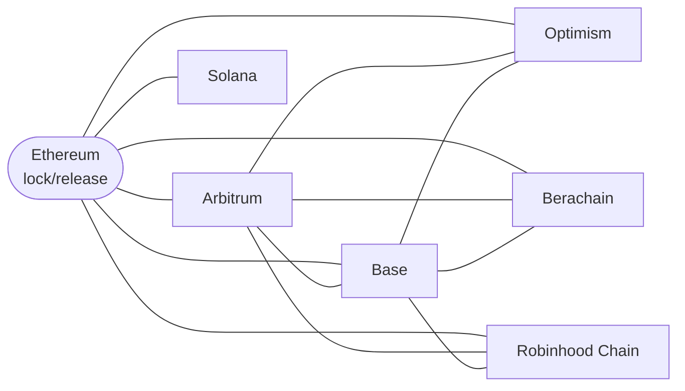

# Cross-Chain Bridge

## Overview

OHM is available on more than one chain. Olympus moves **native OHM** between the supported chains. Each chain has one OHM token, and the bridge does not issue a separate bridge token. Thus, the OHM that you receive on a chain is composable with every dApp on that chain.

All bridge lanes use [Chainlink CCIP](https://chain.link/cross-chain) (Cross-Chain Interoperability Protocol). Each chain has a CCIP **token pool** that holds the OHM accounting for that chain:

- On **Ethereum**, the token pool **locks** OHM when it leaves Ethereum and **releases** OHM when it returns.
- On **Arbitrum, Optimism, Base, Berachain, Robinhood Chain and Solana**, the token pool **burns** OHM when it leaves the chain and **mints** OHM when it arrives.

Ethereum is the **canonical chain** for OHM. Only Ethereum can mint net-new protocol OHM. The OHM on every other chain is backed by OHM that is locked in the Ethereum token pool. Bridging does not change the total supply of OHM.

:::caution Rollout status

The CCIP lanes between Ethereum and Arbitrum, Optimism, Base, Berachain and Robinhood Chain open after the OCG proposal "CCIP Bridge Activation" executes. Until then, only the lane between Ethereum and Solana is available. The contracts on all chains are deployed. Their addresses are in [Technical Details](./01_ccip-technical-details.md#deployments).

:::

For the architecture, the access control, the rate limits and the emergency controls, refer to [Cross-Chain Bridge: Technical Details](./01_ccip-technical-details.md).

## How to bridge

1. Go to the [Bridge](https://app.olympusdao.finance/#/ohm/bridge) page.
2. Select the source chain and the destination chain.
3. Enter the amount, approve OHM and click **Bridge**.
4. Find the transaction in the **Transactions** list. You can also find the message in the [CCIP Explorer](https://ccip.chain.link) with its message ID or its transaction hash.

Olympus does not charge a fee for bridging. You pay the gas on the source chain and the CCIP fee in the native token of the source chain.

The time for a transfer depends on the finality of the source chain. The CCIP Explorer shows the status of each transfer.

:::info Bridging to Solana

The recipient wallet on Solana must have an OHM associated token account before the transfer arrives. CCIP does not create this account. If the account does not exist, the transfer fails on Solana. To complete the transfer, create the account. Then execute the message manually from the [CCIP Explorer](https://ccip.chain.link).

:::

## Supported networks

Ethereum, Arbitrum, Optimism, Base, Berachain, Robinhood Chain and Solana.

## Bridge lanes

Each line in the diagram is a lane that operates in the two directions. Ethereum connects to every chain. Arbitrum and Base connect to every EVM chain.

| From / To       | Ethereum | Arbitrum | Optimism | Base | Berachain | Robinhood Chain | Solana |
| --------------- | :------: | :------: | :------: | :--: | :-------: | :-------------: | :----: |
| Ethereum        |    -     |   Yes    |   Yes    | Yes  |    Yes    |       Yes       |  Yes   |
| Arbitrum        |   Yes    |    -     |   Yes    | Yes  |    Yes    |       Yes       |   No   |
| Optimism        |   Yes    |   Yes    |    -     | Yes  |    No     |       No        |   No   |
| Base            |   Yes    |   Yes    |   Yes    |  -   |    Yes    |       Yes       |   No   |
| Berachain       |   Yes    |   Yes    |    No    | Yes  |     -     |       No        |   No   |
| Robinhood Chain |   Yes    |   Yes    |    No    | Yes  |    No     |        -        |   No   |
| Solana          |   Yes    |    No    |    No    |  No  |    No     |       No        |   -    |

The mechanism of a lane depends on the source and the destination:

| Lane                                   | Mechanism                                                                                                 |
| -------------------------------------- | --------------------------------------------------------------------------------------------------------- |
| Ethereum &rarr; other chain            | OHM is locked in the Ethereum token pool. Native OHM is minted on the destination chain.                  |
| Other chain &rarr; Ethereum            | OHM is burned on the source chain. OHM is released from the Ethereum token pool.                          |
| Between two chains other than Ethereum | OHM is burned on the source chain and minted on the destination chain. The Ethereum pool does not change. |

Chainlink has no lane between Optimism and Berachain, between Optimism and Robinhood Chain, or between Berachain and Robinhood Chain. To move OHM between these chains, bridge through Arbitrum, Base or Ethereum.

The lanes between Solana and the other chains (not Ethereum) are not part of the rollout. The DAO adds them later, through the configuration timelock of each chain. Until then, to move OHM between Solana and one of these chains, bridge through Ethereum.

## Migration from the LayerZero bridge

Before CCIP, the OHM on Arbitrum, Optimism, Base and Berachain came from the LayerZero `CrossChainBridge`. That bridge is closed. The CCIP rollout deactivates it on each chain.

You do not need to do anything with your OHM. The OHM token address on each chain does not change, and your OHM stays valid. Before the new lanes open, the DAO Multisig deposits OHM into the Ethereum token pool. This deposit is equal to the OHM supply on Arbitrum, Optimism, Base and Berachain (approximately 130,721 OHM). Thus, the pool can release OHM on Ethereum for all of the OHM that the LayerZero bridge minted on those chains.

Robinhood Chain is new to Olympus. The LayerZero bridge did not serve it. Its OHM token starts with a supply of zero, and all of its OHM arrives through CCIP. Thus, Robinhood Chain does not increase the deposit.

## Security

### What "native" means

Bridges are the cause of approximately half of all DeFi exploits.

The Olympus bridge uses lock-and-mint accounting between Ethereum and the other chains. This is the same mechanism that many bridges use. The difference is the issuer of the token on the destination chain:

- A typical bridge issues its own wrapped token. The bridge operator controls that token, and each bridge creates a different representation of the same asset.
- On Arbitrum, Optimism, Base, Berachain and Robinhood Chain, OHM is an Olympus token. Only the Olympus Kernel of that chain can mint it, through the `MINTR` module. Each chain has one OHM token, and all bridge transfers use it.

Thus, Olympus can change the bridge provider and keep the token. For example, the OHM token addresses on the EVM chains do not change in the move from LayerZero to CCIP.

On Solana, the CCIP token pool and its owner are Chainlink contracts. Olympus does not hold a role on the Solana pool.

### The Ethereum token pool

The Ethereum token pool holds the OHM that backs every other chain. Thus, like the lock contract of any lock-and-mint bridge, it is a concentration of value. The guardrails that follow limit the risk to the pool.

### Guardrails

- **Supply bound.** OHM can return to Ethereum only from the Ethereum token pool. If an attacker mints OHM on another chain, the amount that can return to Ethereum is limited to the OHM in the pool. The bridge cannot mint new OHM on Ethereum.
- **Release limit.** Only a verified CCIP message can release OHM from the pool. The inbound rate limit of each route also limits the OHM that the pool can release in 24 hours. In an incident, the Emergency Multisig can stop all routes immediately, and an OCG proposal can withdraw OHM from the pool.
- **Rate limits.** Each route has an outbound limit and an inbound limit on each side. The limits refill over 24 hours. A limit stops a large or sudden flow, also if a different control fails.
- **Message verification.** The Chainlink decentralized oracle network verifies each CCIP message. The independent Risk Management Network can also stop a lane.
- **Timelock on configuration.** On Ethereum, the DAO Multisig queues route and rate-limit changes on a timelock. A change can execute only after a delay of 1 day. Each queued change is visible on-chain, and the Emergency Multisig can cancel it. On the other EVM chains, there is no OCG. The local DAO Multisig holds the `admin` role there, and it can change routes and rate limits directly, without the delay.
- **Governance ownership.** On Ethereum, the Olympus on-chain governance (OCG) timelock holds the `admin` role, the OHM administrator role in the Chainlink registry, and the rebalancer role of the pool. These roles control the token pool registration, the pool liquidity and the root configuration. The DAO Multisig does not hold these roles. The DAO Multisig is the Kernel executor, which activates and deactivates policies.
- **Emergency controls.** The DAO Multisig and the Emergency Multisig can each stop a route, or all routes, immediately. These controls only decrease capacity.

No design removes all risk. The bridge depends on Chainlink CCIP. A failure of CCIP or a compromise of CCIP can have an effect on the bridge. The guardrails limit that effect and give the community time to respond.

### Audits

- **Electisec (June 2025):** the CCIP token pool and the `CCIPCrossChainBridge` contracts.
- **Cyfrin (September 2026):** the CCIP token pool configuration policy, the configuration timelock and the rollout to the EVM chains.

The [Electisec report](../../security/02_audits.md#ccip-bridge) is in the Audits section. The [Cyfrin report](../../security/02_audits.md#ccip-token-pool-config) will be added to the Audits section when it is published.

Robinhood Chain uses the same contracts as the other EVM chains.

## Contracts

The bridge contract addresses for each chain are in [Technical Details](./01_ccip-technical-details.md#deployments) and in the [contract addresses table](../../contracts/01_addresses.md). The roles and the holders of each role are in [Security Roles](../../security/01_roles.md#ccip-bridge).

## Governance

- [RFC: Expand OHM Bridging with Chainlink CCIP](https://forum.olympusdao.finance/d/5548-rfc-expand-ohm-bridging-with-chainlink-ccip)
- [OIP-198: Expand OHM Bridging with Chainlink CCIP](https://forum.olympusdao.finance/d/5596-oip-198-expand-ohm-bridging-with-chainlink-ccip)
